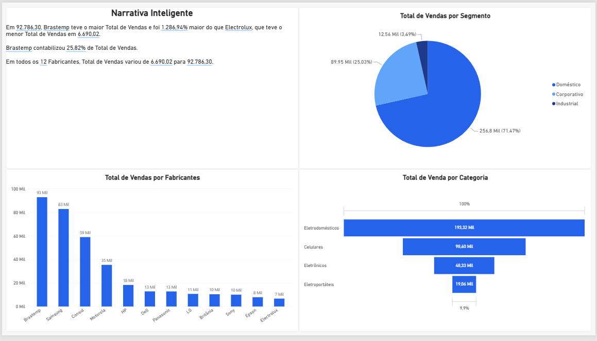
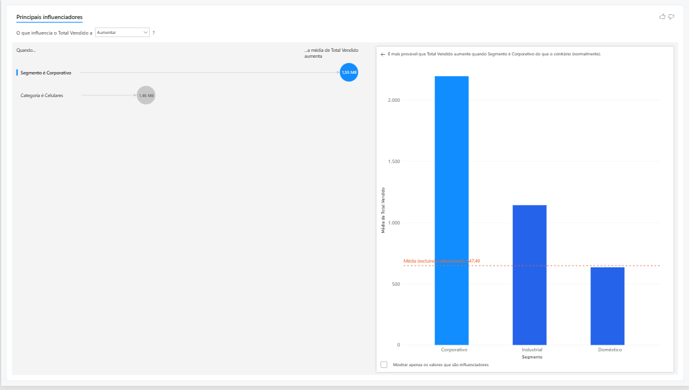
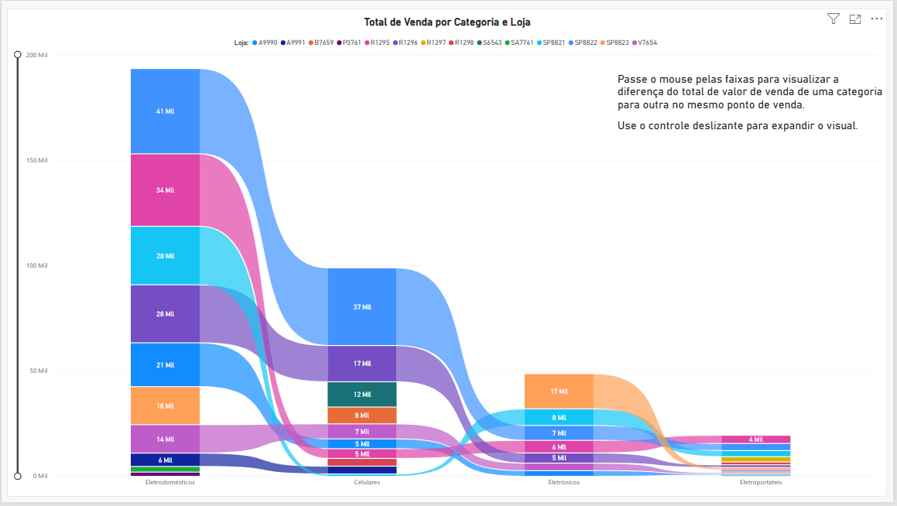

## 📊 Dashboard Comercial — Performance de Vendas com Power BI

## 🎯 Sobre o projeto

Mini-projeto desenvolvido durante o curso **Microsoft Power BI para Business Intelligence e Data Science**, da Data Science Academy (DSA), com o objetivo de analisar o desempenho comercial por meio de indicadores, visualizações interativas e recursos analíticos do Power BI.

O dashboard permite explorar as vendas por segmento, categoria de produto, fabricante, ponto de venda, região e vendedor, facilitando a comparação de resultados e a identificação de fatores associados ao desempenho comercial.

## 🛠️ Ferramenta utilizada

- Power BI Desktop

## 📈 Análises realizadas

O projeto foi organizado em diferentes páginas, cada uma com uma perspectiva de análise.

## 📊 1. Narrativa Inteligente

Apresentação de informações relevantes sobre o desempenho das vendas, incluindo:

- Comparação do total vendido entre fabricantes;

- Identificação dos fabricantes com maior e menor volume de vendas;

- Participação dos fabricantes no total vendido;

- Distribuição das vendas por segmento;

- Comparação das vendas entre categorias de produtos.

## 🔎 2. Principais Influenciadores de Vendas

Utilização do visual de Principais Influenciadores do Power BI para explorar fatores associados ao aumento do total vendido.

A análise permite investigar relações entre o desempenho das vendas e variáveis como:

- Segmento comercial;

- Categoria de produto;

- Média do total vendido.

## 🏪 3. Faixas de Vendas por Categorias e Pontos de Venda

Análise da distribuição do total vendido entre categorias de produtos e lojas, permitindo:

- Comparar o desempenho das categorias;

- Explorar diferenças entre pontos de venda;

- Identificar como as vendas de cada categoria se distribuem entre as lojas.

## 🗺️ 4. Performance dos Vendedores por Região

Análise geográfica das vendas por estado e vendedor, permitindo visualizar a distribuição regional dos resultados e comparar o desempenho dos vendedores representados no relatório.

## 📊 Visualizações e recursos utilizados

O dashboard reúne diferentes recursos de visualização e análise do Power BI:

- **Mapa geográfico**: distribuição das vendas por estado e vendedor;

- **Gráfico de faixas de vendas**: comparação das vendas entre categorias e pontos de venda;

- **Principais Influenciadores**: exploração de fatores associados ao total vendido;

- **Narrativa Inteligente**: apresentação automática de informações relevantes sobre os dados;

- **Gráfico de pizza**: participação dos segmentos no total de vendas;

- **Gráficos de barras**: comparação do desempenho entre fabricantes;

- **Gráfico de funil**: visualização do total vendido por categoria;

- **Página de índice**: navegação entre as páginas do relatório.

## 🔎 Principais informações apresentadas

Com base nos resultados exibidos no dashboard, destacam-se:

- **Brastemp**: aproximadamente 92,8 mil em vendas, o maior valor entre os fabricantes apresentados;

- **Electrolux**: aproximadamente 6,69 mil em vendas, o menor valor entre os fabricantes apresentados;

- **Eletrodomésticos**: aproximadamente 193,32 mil em vendas, a maior categoria entre as quatro apresentadas;

- **Celulares**: aproximadamente 98,60 mil em vendas;

- **Segmento Doméstico**: aproximadamente 256,8 mil, equivalente a 71,47% do total apresentado no gráfico por segmento.

O visual de Principais Influenciadores também destaca o segmento Corporativo como um fator associado ao aumento da média do total vendido na análise apresentada.

Esses resultados ajudam a demonstrar como o Power BI pode ser utilizado para comparar o desempenho comercial e explorar diferentes perspectivas dos dados.

## 🖼️ Dashboard

## 📑 Índice do relatório

## 📊 Narrativa Inteligente

## 🔎 Principais Influenciadores de Vendas

## 🏪 Faixas de Vendas por Categorias e Pontos de Venda

## 🗺️ Performance dos Vendedores por Região

## 🎓 Contexto

Projeto desenvolvido como parte do curso **Microsoft Power BI para Business Intelligence e Data Science**, da Data Science Academy (DSA).

## 👨‍💻 Autor

**Vinicius Marques**

Análise e Desenvolvimento de Sistemas | Power BI | Excel | SQL | Análise de Dados
